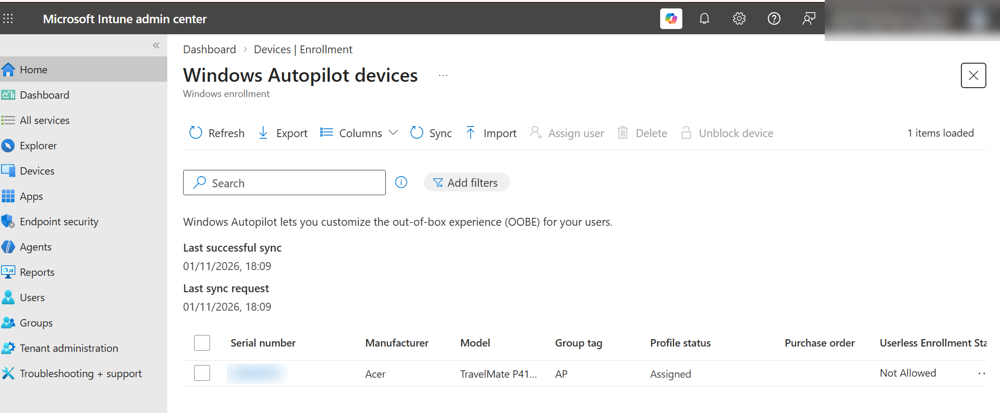
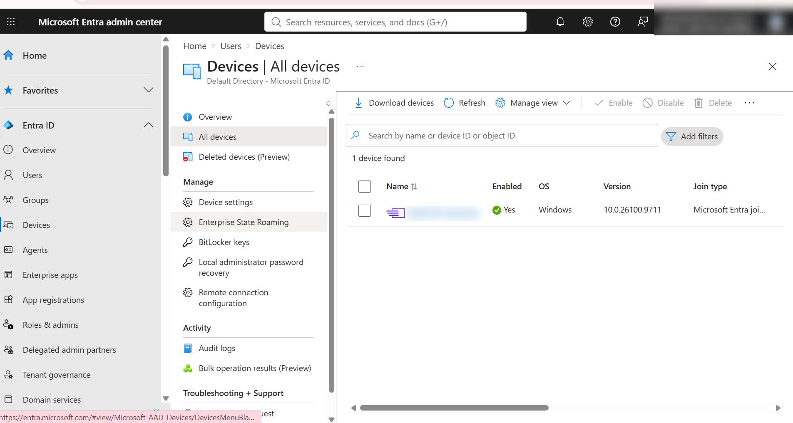

# Windows Autopilot & Microsoft Intune: Zero-Touch Device Deployment


---

## Project Highlights

- End-to-end **zero-touch Windows provisioning** with Windows Autopilot and Microsoft Intune
- **Dynamic Entra ID group** driven by Autopilot group tag for automatic profile targeting
- **User-driven, Microsoft Entra joined** deployment profile with a prioritized **Enrollment Status Page** policy
- Automatic **Intune MDM enrollment** with corporate ownership and primary user mapping
- Post-deployment validation across **Intune and Entra ID**, ending in a **Compliant** device
- Fully documented with architecture flow, screenshots and key learnings

---

## Project Overview

This project demonstrates an end-to-end **zero-touch Windows device provisioning workflow in a lab environment**. It covers Autopilot device registration, dynamic device group assignment, deployment profile and Enrollment Status Page (ESP) configuration, Microsoft Entra ID join, Intune enrollment, and compliance validation through Microsoft cloud-based endpoint management solutions.

The goal is to simulate how an enterprise IT team delivers a ready-to-use, managed laptop to a user with no manual imaging and no hands-on IT time.

---

## Objectives

- Register a corporate Windows device in **Windows Autopilot**
- Automate profile targeting with a **dynamic Entra ID security group**
- Configure a **user-driven, Entra-joined** Autopilot deployment profile
- Assign an **Enrollment Status Page** policy to Autopilot devices
- Validate **Entra ID join**, **Intune enrollment** and **compliance** after provisioning

---

## Technologies Used

| Area | Technology |
|---|---|
| Device management | Microsoft Intune |
| Provisioning | Windows Autopilot |
| Identity | Microsoft Entra ID |
| Targeting | Dynamic security groups, group tags |
| Operating system | Windows 11 Enterprise |
| Test device | Windows 11 Test Device (corporate-owned) |

---

## Architecture / Workflow

```
 Hardware Hash Registered in Autopilot (Group Tag: AP)
                    |
                    ▼
 Dynamic Device Group Assignment  (rule: group tag match)
                    |
                    ▼
 Autopilot Deployment Profile + ESP Policy Applied
                    |
                    ▼
 OOBE Experience  (user-driven)
                    |
                    ▼
 Microsoft Entra ID Join
                    |
                    ▼
 Automatic Intune Enrollment
                    |
                    ▼
 Enrollment Status Page: Device preparation → Device setup → Account setup
                    |
                    ▼
 Compliance Evaluation  →  Compliant, Corporate, Intune-managed
```

---

## Implementation Steps

### 1. Register the device in Windows Autopilot
The device was imported into **Devices > Enrollment > Windows Autopilot devices** with group tag `AP`. After a sync, the profile status showed **Assigned**.



### 2. Create the dynamic device group
A dynamic security group named `AUTOPILOT` was created. Its membership rule matches devices carrying the Autopilot group tag, so any newly registered device is targeted automatically.

```
(device.devicePhysicalIds -any (_ -contains "[OrderID]:AP"))
```


### 3. Configure the Autopilot deployment profile
The `AUTOPILOT` profile uses **User-Driven** deployment mode and **Microsoft Entra joined**, and is assigned to the dynamic group.


### 4. Assign the Enrollment Status Page policy
An ESP policy named `AUTOPILOT` was set at priority 1 and assigned, above the default policy, so Autopilot devices show setup progress during provisioning.


### 5. Run OOBE and observe the Enrollment Status Page
The device was started and the user signed in with a work account. The ESP tracked **Device preparation**, **Device setup** and **Account setup**.


### 6. Validate Microsoft Entra ID join
The device object was created automatically in Entra ID: enabled, Windows 11, join type **Microsoft Entra joined**.



### 7. Validate Intune enrollment and compliance
The device appears in Intune as **Managed by Intune**, **Corporate**, **Compliant**, with a primary user assigned.


---

## Results

| Checkpoint | Result |
|---|---|
| Device registered in Autopilot | Pass |
| Dynamic group targeting configured | Pass |
| Deployment profile assigned | Pass |
| ESP displayed during OOBE | Pass |
| Entra ID join | Pass |
| Intune enrollment (Corporate) | Pass |
| Compliance state | Compliant |


> Observation: the Intune dashboard flagged **1 device configuration policy with an error or conflict**. This is noted as a follow-up troubleshooting item.

---

## Key Learnings

- The hardware hash and group tag are what let Autopilot recognize and configure a device before the user touches it.
- Dynamic groups remove manual assignment and scale to any number of devices.
- The ESP holds the desktop until required configuration is applied.
- Entra ID and Intune keep separate device records, so both need to be checked.
- Group membership, Autopilot sync and compliance evaluation take time, so patience and re-sync are part of troubleshooting.

---

## Skills Demonstrated

### Endpoint Management
- Microsoft Intune
- Windows Autopilot
- MDM Enrollment
- Enrollment Status Page (ESP)

### Identity
- Microsoft Entra ID
- Device Join
- Device Lifecycle Management
- Dynamic Group Membership Rules

### Security & Compliance
- Compliance Policy Validation
- Corporate Device Ownership

### Operations
- Device Inventory
- Deployment Validation
- Troubleshooting
- Documentation

---

## Future Improvements

- Deploy Win32 and Microsoft 365 apps tracked by the ESP
- Add security baselines (BitLocker, Defender, firewall)
- Configure Windows Update rings
- Enforce Conditional Access that requires compliant devices
- Test Autopilot pre-provisioning and self-deploying modes
- Automate device import with PowerShell and Microsoft Graph

---

## Repository Structure

```
intune-autopilot-zero-touch-deployment/
├── README.md
└── screenshots/
    ├── 01-autopilot-device-imported.png
    ├── 02-enrollment-status-page.jpg
    ├── 03-entra-id-joined.png
    ├── 04-device-enrolled-compliant.png
    ├── 05-autopilot-deployment-profile-list.png
    ├── 06-autopilot-profile-overview.png
    ├── 07-enrollment-status-page-policy.png
    ├── 08-autopilot-dynamic-group.png
    ├── 09-dynamic-membership-rule.png
    └── 11-intune-dashboard.png
```

---

## Author

### Akshay Sharma

- LinkedIn: https://www.linkedin.com/in/akshay-sharma-741057237
- GitHub: https://github.com/akshay-shar500

*This lab project was created to gain hands-on experience with Microsoft Intune, Windows Autopilot, and Enterprise Endpoint Management.*
